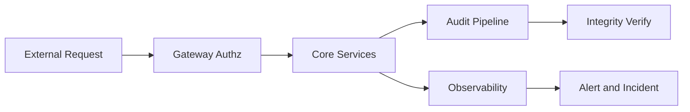
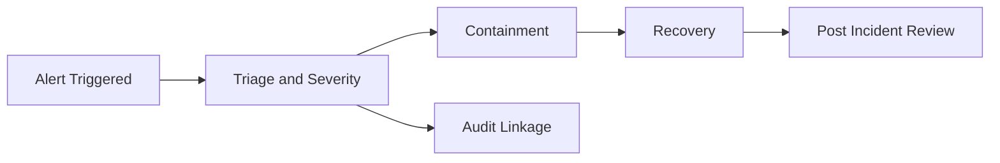

# 安全 隱私 與可觀測性架構補充規格 v1

> 文件狀態：Draft v1 可審閱  
> 子任務：Phase 1.2 Security and Observability Architect  
> 依據與對齊文件：
> - docs/architecture/system_architecture_spec_v1.md
> - docs/architecture/api_contracts_v1.md
> - docs/governance/audit_logging_and_retention_policy_v1.md
> - docs/governance/latency_budget_and_measurement_spec_v1.md
> - docs/governance/raci_and_decision_sla_v1.md

---

## 1. 文件目的與範圍

本文件在既有系統架構與治理文件基線上，補充 MVP 階段安全 隱私 與可觀測性之可審閱規格，供 PM Security Backend MLOps 共同會審。

適用範圍僅限以下流程：

1. 資料上傳  
2. 前處理  
3. 風險分數推論  
4. 結果解釋  
5. 報表匯出

不在本版範圍：

- 法條逐條映射實作細節
- 跨區主備主動切換自動化流程實作
- IAM 與 KMS 實際供應商細部設定

---

## 2. 威脅模型

### 2.1 建模方法與風險分級

- 建模方法：以 STRIDE 類別與資料流階段組合檢視。  
- 風險等級：High Medium Low，依可利用性 影響面 可偵測性綜合判定。  
- 控制原則：預防 優先於偵測，偵測 優先於事後補償。

### 2.2 威脅清單與控制

| Threat ID | 威脅描述 | 攻擊面 | 風險等級 | 主要緩解控制 | 觀測與審計證據 |
|---|---|---|---|---|---|
| T01 | 偽造或重放 `X-Trace-Id` `X-Request-Id` 造成追溯污染 | API Gateway Header | High | Gateway 重新簽發內部 request_id 並驗證格式；拒收異常 ID；重放檢測 | `auth.authorization.denied` `system.exception.raised` 關聯追溯 |
| T02 | `Idempotency-Key` 重用導致重複建立批次或匯出任務 | `POST /api/v1/uploads` `POST /api/v1/reports/exports` | High | 冪等鍵與請求摘要綁定；衝突回 `IDEMP-409-CONFLICT`；TTL 與重送視窗治理 | API 回應碼與審計事件一致性抽測 |
| T03 | 惡意 CSV 注入公式或超大檔案耗盡資源 | Upload Ingestion | High | 檔案大小上限 MIME 與內容雙檢核；危險字首清理；早期拒絕 | `data.upload.received` `data.upload.validated` |
| T04 | 未授權存取結果查詢與報表下載 | Result API Download URL | High | RBAC ABAC 雙層檢查；短效下載連結；單次存取簽章 | `result.viewed` `report.export.generated` |
| T05 | 審計日誌遭竄改或刪除 | Audit Pipeline Storage | High | Append only Hash Chain WORM 等效；刪除雙人覆核 | `integrity_hash` 驗證報告與刪除審批紀錄 |
| T06 | 推論請求暴力打點造成服務降級 | Inference API | High | Rate limit 配額 分層熔斷；錯誤快返；保護 S5 S6 資源 | timeout_rate error_rate 告警與工單閉環 |
| T07 | 錯誤訊息外洩敏感資料 | API Error Log | Medium | 錯誤訊息去敏；禁止記錄明文 token secret；例外堆疊清洗 | `error_message_sanitized` 抽驗 |
| T08 | 機敏欄位在 traces 或 metrics 洩漏 | Observability Pipeline | High | span attribute allowlist；禁止原始特徵值入 traces；聚合後再輸出 | 觀測欄位字典稽核與抽樣查核 |
| T09 | 模型或規則版本被未授權替換 | Inference Service Config | High | 版本簽章驗證；變更需 `system.config.changed` 與雙簽核 | 設定變更審計鏈與簽章參照 |
| T10 | 憑證與金鑰硬編碼或外洩 | CI CD Runtime Secret | High | 集中式 Secret Manager；禁止寫入 repo；啟用密鑰掃描 | 秘密掃描報告與輪替紀錄 |
| T11 | 非同步佇列訊息被重放或亂序 | Preprocess Export Worker | Medium | 訊息簽章與 nonce；消費端去重；順序敏感流程加版本檢查 | job 狀態轉移審計與重試鏈 |
| T12 | 供應鏈套件漏洞導致遠端執行風險 | Build Dependency | Medium | SCA 掃描與封鎖高風險套件；基底映像簽章 | 弱點掃描報告與修補追蹤 |

### 2.3 威脅到控制映射摘要

---

## 3. 隱私保護策略

### 3.1 資料最小化

1. API 層僅接受契約必要欄位，禁止額外自由欄位落地。  
2. 審計層不得記錄原始特徵值，僅記錄 `schema_version` 欄位集合版本與聚合結果。  
3. 推論結果預設保留 `risk_score_bucket`，精確分數保存策略列為待確認。

### 3.2 遮罩策略

| 資料類型 | 規則 | 範例 |
|---|---|---|
| 使用者識別 | 部分遮罩或 token 化 | `u12***89` |
| 裝置或來源資訊 | 僅保留必要片段或雜湊 | device_fingerprint_hash |
| 檔名與路徑 | 只存模板，不存本機完整路徑 | `upload_yyyymmdd_batch.csv` |
| 錯誤訊息 | 去敏後落地 | 移除 token secret 個資片段 |

### 3.3 去識別化邊界

| 邊界層 | 允許資料 | 禁止資料 | 控制機制 |
|---|---|---|---|
| Upload Ingestion | 去識別化 CSV metadata | 可直接識別個資欄位 | Schema Gate + Data Dictionary 白名單 |
| Feature Pipeline | 特徵向量與版本資訊 | 原始身分識別欄位 | 欄位映射規則與落地前檢查 |
| Audit Logging | 事件 metadata 關聯 ID | 原始 payload 明文 | 審計欄位字典 + 去敏處理 |
| Observability | 聚合 metric 與標準 span 標籤 | 原始特徵值與可逆識別值 | telemetry allowlist policy |

### 3.4 存取控制

1. 採最小權限原則，角色權限對齊審計政策矩陣。  
2. 報表匯出與審計查詢需留痕，且必須能以 `trace_id` `request_id` 回查。  
3. 特權操作需雙人覆核，含保留期變更與資料刪除流程。

---

## 4. 金鑰與密鑰管理政策

### 4.1 管理範圍

- API 簽章密鑰  
- 資料庫連線秘密  
- 佇列簽章密鑰  
- 審計簽章參照密鑰

### 4.2 生命週期政策

| 項目 | v1 建議值 | 原則 |
|---|---|---|
| 輪替週期 | 建議 90 天 | 一律標示待確認，不宣告固定門檻 |
| 緊急輪替 | 事故判定後立即啟動 | 對應 P1 事件流程 |
| 版本控管 | 每次輪替產生 key version | 舊版可讀不可再寫 |
| 失效與撤銷 | 外洩或可疑即撤銷 | 需有回滾與相容窗口 |

### 4.3 存放與存取

1. 密鑰僅可存放於集中式 Secret Manager 或 KMS 等效服務。  
2. 禁止寫入程式碼庫 設定檔 明文日誌。  
3. 權限分離：使用權與管理權分離，管理操作需審批並產生 `system.config.changed`。

### 4.4 權限治理

| 動作 | 最低角色要求 | 稽核要求 |
|---|---|---|
| 讀取執行期秘密 | 服務身分或授權維運角色 | 讀取留痕 |
| 產生新版本密鑰 | security compliance 授權角色 | 審批編號與簽核留痕 |
| 失效撤銷密鑰 | security compliance + 平台雙簽 | 關聯事件與影響清單 |

---

## 5. 可觀測性藍圖

### 5.1 三支柱規範 logs metrics traces

| 類型 | 必備欄位 | 禁止內容 | 目的 |
|---|---|---|---|
| logs | timestamp service severity trace_id request_id error_code | 明文 secret token 原始特徵值 | 故障定位與稽核 |
| metrics | endpoint stage scenario_id percentile error_rate | 可逆個資值 | SLA 監控與容量規劃 |
| traces | trace_id request_id span_id parent_span_id stage | 原始 payload 特徵明文 | 跨服務延遲與依賴分析 |

### 5.2 關聯 ID 規範

1. `trace_id`：單一業務請求鏈路固定不變。  
2. `request_id`：每 hop 新值且可回連 parent。  
3. `upload_batch_id` `preprocess_job_id` `result_id` `export_id`：依流程補充攜帶，支援跨系統取證。

### 5.3 觀測事件與審計事件對齊

| 場景 | 觀測輸出 | 審計輸出 | 對齊要點 |
|---|---|---|---|
| 推論逾時 | timeout_rate stage_latency_ms | `system.exception.raised` | 以 trace_id request_id 串接 |
| 權限拒絕 | auth_denied_count | `auth.authorization.denied` | error_code 一致 |
| 匯出任務失敗 | export_failed_count | `report.export.generated` result failure | export_id 可追溯 |

---

## 6. 告警與事件回應流程

### 6.1 告警分級與決策 SLA 對應

| 等級 | 觸發條件範例 | 首次回應 | 臨時緩解 | 正式決策 | 對齊文件 |
|---|---|---|---|---|---|
| P1 | 法遵重大風險 或 E2E P95 長時間超標 | 30 分鐘內 | 2 小時內 | 8 小時內 | RACI and Decision SLA |
| P2 | 關鍵段 S4 S5 S6 連續超窗 | 2 小時內 | 8 小時內 | 24 小時內 | RACI and Decision SLA |
| P3 | 容量趨勢異常或低風險議題 | 1 日曆日內 | 3 日曆日內 | 下次治理會議前 | RACI and Decision SLA |

### 6.2 事件回應流程

最小輸出要求：

1. 事件等級與時間軸。  
2. 受影響端點 模組 與資料範圍。  
3. 緩解措施與回滾條件。  
4. 關聯審計事件編號與取證索引。

---

## 7. 災難復原與營運連續性

### 7.1 RTO RPO 建議值 v1

| 服務範圍 | RTO 建議值 | RPO 建議值 | 狀態 |
|---|---|---|---|
| 核心推論 API | 建議 4 小時 | 建議 15 分鐘 | 待確認 |
| 審計查詢能力 | 建議 8 小時 | 建議 30 分鐘 | 待確認 |
| 報表匯出非同步 | 建議 24 小時 | 建議 4 小時 | 待確認 |

> 本版僅提供建議值，全部列為待確認，不宣告固定承諾門檻。

### 7.2 復原策略

1. 資料層採定期備份與完整性驗證。  
2. 服務層採可替換部署與最小啟動清單。  
3. 審計層需先恢復可查詢與完整性驗證能力，再恢復次要分析功能。

### 7.3 演練節奏

| 演練類型 | 建議節奏 | 驗證重點 |
|---|---|---|
| 桌上演練 | 每月一次 | 決策鏈 通報鏈與角色責任 |
| 技術切換演練 | 每季一次 | RTO RPO 實測與回滾 |
| 審計取證演練 | 每季一次 | trace_id request_id 到 evidence package 全鏈追溯 |

---

## 8. 跨文件一致性檢核

### 8.1 對齊檢核表

| 檢核面向 | 對齊文件 | 本文件對齊狀態 | 備註 |
|---|---|---|---|
| 追蹤欄位 `trace_id` `request_id` | api contracts v1 + audit policy v1 | 已對齊 | 關聯 ID 規範一致 |
| 審計事件名稱字典 | audit policy v1 | 已對齊 | 使用既有 event_name |
| 延遲段 S1 到 S7 | latency spec v1 + system architecture v1 | 已對齊 | 告警條件沿用分段治理 |
| P1 P2 P3 決策時限 | raci and decision sla v1 | 已對齊 | 事件回應章節明確映射 |
| API 錯誤碼 | api contracts v1 | 已對齊 | 安全事件與錯誤碼綁定 |
| 審計保留 online archive | audit policy v1 | 已對齊 | 保留期仍待法遵簽核 |

### 8.2 差異與風險提示

1. RTO RPO 與密鑰輪替週期僅為建議值，尚未簽核。  
2. 精確風險分數保存政策仍待確認，避免與審計最小揭露衝突。  
3. 健康檢查端點審計覆蓋深度需再確認。

---

## 9. 尚待確認事項

1. `Idempotency-Key` 正式 TTL 與跨端點一致策略。  
2. 金鑰輪替週期是否採 90 天，或依事件等級分層。  
3. RTO RPO 建議值是否可作為正式 SLO。  
4. 審計 online 與 archive 保留期最終簽核值。  
5. 推論精確分數是否允許保存於受控區。  
6. 報表下載連結有效期與一次性存取策略。  
7. 健康檢查端點是否納入法遵必記錄事件。  
8. 告警事件是否需強制寫入工單系統並雙向關聯。  
9. 事故期間是否允許啟用保留凍結以延後刪除。  
10. 觀測平台 span attribute 欄位字典最終白名單。

---

## 10. 版本控管

- 版本：v1  
- 狀態：Draft v1 可審閱  
- 進版條件：跨 PM Security Backend MLOps 會審通過，且第 9 節事項完成簽核

