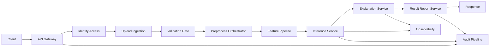

# 系統架構規格 v1

> 文件狀態：Draft v1 可審閱  
> 子任務：Phase 1.1 System Architect  
> 依據文件：
> - docs/governance/data_dictionary_and_label_definition_v1.md
> - docs/governance/audit_logging_and_retention_policy_v1.md
> - docs/governance/latency_budget_and_measurement_spec_v1.md
> - docs/governance/raci_and_decision_sla_v1.md

---

## 1. 系統目標與範圍

### 1.1 MVP 系統目標

本系統以糖尿病風險預測輔助為目標，MVP 僅涵蓋以下五段業務能力：

1. 資料上傳  
2. 前處理  
3. 風險分數推論  
4. 結果解釋  
5. 報表匯出

### 1.2 架構範圍邊界

| 範圍類型 | 納入範圍 | 不在本版範圍 |
|---|---|---|
| 資料來源 | 去識別化 CSV 上傳批次 | 非 CSV 來源與即時串流 |
| 推論模式 | API 單筆推論為主 另含批次結果查詢 | 多模型編排與線上學習 |
| 解釋能力 | 風險結果解釋輸出與版本追蹤 | 可視化互動式解釋平台 |
| 治理要求 | 審計可追溯 保留政策 對應延遲預算 | 法規條文細部落地程序 |
| 驗收關聯 | P95 小於 500ms 審計日誌可保留可追溯 | 超出 MVP 之高可用跨區容災 |

### 1.3 架構設計原則

1. 全鏈路以 `trace_id` 與 `request_id` 貫通。  
2. 依延遲預算拆分同步主路徑與非同步支路徑。  
3. 審計事件採法遵必記錄優先，關鍵事件不可關閉。  
4. 模組邊界明確，將責任與失敗域隔離。  
5. 所有未定義事項標記為待確認，不虛構已定結論。

---

## 2. 模組邊界與責任

### 2.1 模組清單

| 模組 ID | 模組名稱 | 主要責任 | 主要輸入 | 主要輸出 | 失敗責任邊界 |
|---|---|---|---|---|---|
| M1 | API Gateway | 路由 驗證 限流 追蹤 ID 注入 | HTTP 請求 | 轉發請求與拒絕回應 | 請求格式錯誤與授權前置失敗 |
| M2 | Identity and Access | 驗證授權 角色與配額檢查 | 使用者憑證 請求上下文 | allow deny 決策 | 權限不足或驗簽失敗 |
| M3 | Upload Ingestion | 接收 CSV 上傳與批次註冊 | 上傳檔案 metadata | `upload_batch_id` 與接收回執 | 檔案規格不符與檔案層拒收 |
| M4 | Data Validation and Schema Gate | 欄位 型別 值域 品質 Gate 驗證 | CSV 內容 schema_version | 驗證報告 gate_result | Must Gate 失敗即隔離批次 |
| M5 | Preprocess Orchestrator | 前處理流程排程與狀態管理 | 合格批次資料 規則版本 | `preprocess_job_id` 與特徵資料 | 前處理作業逾時或規則錯誤 |
| M6 | Feature Pipeline | 缺值處理 轉換 特徵生成 | 原始欄位與規則 | 模型輸入特徵向量 | 特徵轉換失敗與洩漏檢核失敗 |
| M7 | Inference Service | 模型載入 推論 執行版本綁定 | 特徵向量 model_version | 風險分數與分箱 | 模型不可用或推論逾時 |
| M8 | Explanation Service | 生成解釋內容與版本標記 | 推論結果 特徵摘要 | 解釋輸出 explain_version | 解釋逾時與降級策略觸發 |
| M9 | Result and Report Service | 查詢結果 產生匯出任務 檔案交付 | 查詢條件 匯出請求 | 結果檢視與 `export_id` | 匯出失敗與權限拒絕 |
| M10 | Audit Logging Pipeline | 審計事件標準化 append only 寫入保留分層 | 事件 metadata 追蹤欄位 | audit event online archive | 審計欄位缺漏與完整性驗證失敗 |
| M11 | Observability and Alerting | 延遲量測 指標聚合 告警升級 | span metric audit 關聯欄位 | 監控圖表 告警事件 | 觀測缺口與告警漏報 |

### 2.2 模組介面關係摘要

| 上游模組 | 下游模組 | 介面性質 | 同步或非同步 | 關鍵資料 |
|---|---|---|---|---|
| M1 | M2 | HTTP 內部呼叫 | 同步 | `trace_id` `request_id` actor context |
| M1 | M3 | HTTP 上傳 | 同步 | file metadata `upload_batch_id` |
| M3 | M4 | 事件驅動或作業觸發 | 非同步 | schema_version row_count |
| M4 | M5 | 作業觸發 | 非同步 | gate_result `upload_batch_id` |
| M5 | M6 | 內部流程呼叫 | 非同步主導 | preprocess_rule_version |
| M6 | M7 | 服務呼叫 | 同步 | feature vector model_version |
| M7 | M8 | 服務呼叫 | 同步 | risk_score_bucket explain_input |
| M7 M8 | M9 | 狀態寫入與查詢 | 非同步寫入 同步查詢 | result_id explain_version |
| 全模組 | M10 | 審計事件寫入 | 非同步主導 關鍵事件可同步補償 | event_name severity integrity_hash |
| 全模組 | M11 | 指標與追蹤 | 非同步 | stage latency error rate |

---

## 3. 端到端資料流

### 3.1 正常流

正常流重點：

1. 上傳接收後產生 `upload_batch_id`。  
2. 僅 `gate_result=pass` 批次可進入前處理。  
3. 推論與解釋沿同步主路徑提供結果。  
4. 審計與觀測採非同步支路徑，避免阻塞主要回應。

### 3.2 錯誤流

| 錯誤節點 | 觸發條件 | 系統動作 | 回應策略 | 審計要求 |
|---|---|---|---|---|
| API Gateway | 請求欄位缺失 格式錯誤 | 立即拒絕 | 4xx 快速回應 | `data.upload.received` `system.exception.raised` |
| Identity and Access | 驗簽失敗 權限不足 | 拒絕存取 | 401 或 403 | `auth.login.failure` 或 `auth.authorization.denied` |
| Validation Gate | Must Gate 失敗 | 批次隔離不進主流程 | 422 與錯誤摘要 | `data.upload.validated` result failure |
| Inference Service | 模型不可用 推論逾時 | 觸發降級或失敗回應 | 503 或 504 | `inference.request.received` `system.exception.raised` |
| Report Service | 匯出生成失敗 | 保留可重試狀態 | 500 或 202 後 failed | `report.export.generated` result failure |

### 3.3 重試流

| 重試場景 | 重試策略 | Idempotency 鍵 | 最大重試邊界 | 追蹤規則 |
|---|---|---|---|---|
| 上傳建立批次 | 客戶端可重送同鍵請求 | `Idempotency-Key` | 相同鍵只建立一次批次 | 同 `trace_id` 新 `request_id` |
| 前處理作業觸發 | 平台作業重試 | `preprocess_job_id` | 超過次數轉 failed | 重試鏈保留 parent request ref |
| 推論請求 | 僅可針對可重試錯誤 | `inference_request_id` 或客戶端鍵 | 禁止無限重試 | 每次 hop 產生新 `request_id` |
| 匯出任務 | 非同步 worker 重試 | `export_id` | 超限後人工介入 | 告警事件需回連 trace sample |

---

## 4. 同步與非同步路徑切分與審計寫入策略

### 4.1 路徑切分原則

| 路徑 | 主要模組 | 設計目的 | 延遲影響 | 一致性要求 |
|---|---|---|---|---|
| 同步主路徑 | M1 M2 M3 M6 M7 M8 M9 | 在回應時限內完成核心業務 | 直接影響 E2E P95 | 回應資料需即時一致 |
| 非同步資料路徑 | M4 M5 M9 匯出後處理 | 承載批次與長作業 | 不計入單筆推論 E2E 主口徑 | 狀態最終一致 |
| 非同步治理路徑 | M10 M11 | 審計與觀測持久化 | 不應阻塞主回應 | 法遵必記錄不可遺失 |

### 4.2 審計日誌寫入策略

| 事件類型 | 寫入方式 | 理由 | 失敗補償 |
|---|---|---|---|
| 法遵必記錄事件 | 非同步寫入為主 同步確認最小落地回執 | 平衡延遲與可稽核 | 若回執失敗 觸發補償佇列與告警 |
| 高風險異常事件 | 同步優先寫入後回應 | 降低不可否認風險 | 寫入失敗時回應受控失敗並告警 |
| 一般資訊事件 | 非同步批次 flush | 降低 S7 阻塞風險 | 允許短暫緩衝但不得越保留策略 |

### 4.3 審計與延遲協調控制

1. S7 段內只執行最小審計落地確認，其餘欄位可延後補齊。  
2. 非同步 audit pipeline 需附 `integrity_hash` 與保留層標記。  
3. 告警觸發事件需回寫審計，以支援事故追溯閉環。

---

## 5. 關鍵路徑與延遲預算映射

### 5.1 S1 到 S7 架構映射

| 延遲段次 | 對應模組 | 關鍵端點類型 | P95 預算 ms | 是否 SLA 關鍵 |
|---|---|---|---:|---|
| S1 請求接收與基本驗證 | M1 | 上傳 推論 查詢 匯出 | 25 | 是 |
| S2 身分授權與配額 | M2 | 全 API | 20 | 是 |
| S3 檔案解析與結構檢核 | M3 M4 | 上傳 前處理啟動 | 60 | 條件式關鍵 |
| S4 前處理與特徵轉換 | M5 M6 | 前處理 推論前置 | 100 | 是 |
| S5 模型推論 | M7 | 推論 | 120 | 是 |
| S6 解釋生成 | M8 | 推論結果輸出 | 90 | 是 |
| S7 回應序列化與審計記錄 | M1 M9 M10 | 全 API 回應收尾 | 30 | 是 |
| 合計 | 主鏈路 | 推論主口徑 | 445 | 是 |

### 5.2 關鍵路徑標註

關鍵路徑說明：

1. 推論主路徑必經 S1 到 S7，屬 SLA 關鍵。  
2. 審計詳盡寫入與報表生成後處理為非同步，不列入單筆推論主口徑。  
3. 若 S5 或 S6 超標，需依治理 SLA 走 P1 或 P2 升級流程。

---

## 6. 治理對齊與角色責任映射

| 治理面向 | 架構落點 | 主要責任角色 | 依據文件對齊 |
|---|---|---|---|
| 資料字典與標籤一致性 | M4 M6 規則版本控管 | DE MLE SA | data dictionary and label definition v1 |
| 審計覆蓋與保留 | M10 事件標準與保留分層 | MOP SC BE | audit logging and retention policy v1 |
| 延遲治理 | M1 M2 M6 M7 M8 M11 | BE MOP MLE | latency budget and measurement spec v1 |
| 決策與升級 | 告警與事件升級流程 | PM SC SA | raci and decision sla v1 |

---

## 7. 待確認事項

1. `Idempotency-Key` 正式 TTL 與重複請求回應碼策略是否固定。  
2. 上傳 API 是否強制單一 `schema_version` 才可受理。  
3. 前處理作業重試上限與人工接手門檻是否需依環境分級。  
4. 解釋服務降級模式是否允許僅回傳摘要等級內容。  
5. 推論結果是否需同時保留精確分數與分箱，或僅保留分箱。  
6. 審計法遵必記錄事件在高峰期間的最小同步落地欄位集合為何。  
7. online 與 archive 保留期是否維持 180 天與 2 年。  
8. 查詢與匯出 API 的角色授權矩陣是否與 IAM 現況完全一致。  
9. S3 段是否對大檔案上傳另立獨立 SLA 與驗收口徑。  
10. S7 段審計落地失敗時是否允許業務回應成功後補償。  
11. 健康檢查端點是否需納入審計必記錄清單。  
12. 事故復盤所需 `trace_id` 樣本數最小要求與留存格式。  

---

## 8. 版本控管

- 版本：v1  
- 狀態：Draft v1 可審閱  
- 進版條件：跨 PM Backend ML MLOps Security Compliance 會審通過與待確認項目完成簽核

