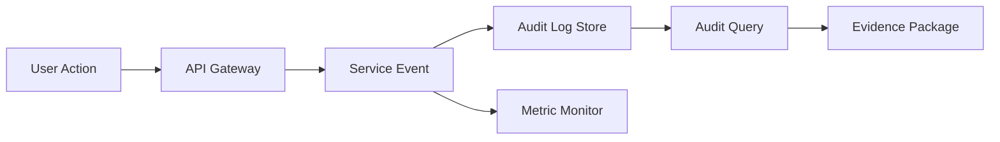

# 審計日誌與保留政策 v1

> 文件狀態：Draft v1（可審閱）  
> 子任務：治理產物 B（Security/Compliance Architect）  
> 唯一依據：糖尿病風險預測輔助專案需求（MVP、資料型態、驗收指標）

---

## 1. 文件目的與適用範圍

本文件定義 MVP 階段可落地的審計治理基線，供 PM、資安、法遵、後端、MLOps 共同會審，涵蓋：

1. 審計事件模型 v1  
2. 審計日誌欄位標準  
3. 保留與存取政策 v1  
4. 驗收對應與 Gate（Must / Should）  
5. 待法遵/資安確認清單

適用流程（僅限已知 MVP）：

- 資料上傳
- 前處理
- 風險分數推論
- 結果解釋
- 報表匯出

資料前提：去識別化 CSV，約 5 萬筆。

---

## 2. 審計事件模型 v1

### 2.1 事件建模原則

- 每個事件必須可追溯到 `trace_id` 與 `request_id`。  
- 涉及人員操作時必須記錄 `user_id` 與 `session_id`。  
- 敏感欄位採最小揭露與遮罩，不記錄原始憑證或可逆機敏內容。  
- 事件分級：`INFO`、`WARN`、`ERROR`、`CRITICAL`。  
- `法遵必記錄=Y` 代表不可關閉、不可抽樣。

### 2.2 審計事件清單與定義

| event_name | 觸發時機 | 必要欄位 | 敏感欄位遮罩策略 | 關聯 ID | 嚴重度 | 法遵必記錄 |
|---|---|---|---|---|---|---|
| auth.login.success | 使用者登入成功時 | timestamp_utc, source_service, user_id, actor_role, action, result | 不記錄密碼/OTP；IP 僅保留遮罩網段；裝置指紋只存雜湊 | trace_id, request_id, user_id, session_id | INFO | Y |
| auth.login.failure | 使用者登入失敗時 | timestamp_utc, source_service, user_id_or_alias, action, result, error_code | 不記錄密碼；帳號僅顯示前後字元中間遮罩；IP 遮罩 | trace_id, request_id, user_id, session_id | WARN | Y |
| auth.authorization.denied | 權限不足被拒時 | timestamp_utc, source_service, user_id, actor_role, object_type, object_id, action, result, error_code | object_id 若可連結個體，僅保留 token 化識別 | trace_id, request_id, user_id, session_id | WARN | Y |
| data.upload.received | 接收 CSV 上傳請求時 | timestamp_utc, source_service, user_id, upload_batch_id, file_name_template, file_size_bytes, action | 檔名去識別化模板；路徑不含本機敏感路徑 | trace_id, request_id, user_id, session_id | INFO | Y |
| data.upload.validated | 上傳資料完成格式/品質檢查時 | timestamp_utc, source_service, upload_batch_id, row_count, schema_version, quality_gate_result | 僅記錄聚合統計，不寫入原始列值 | trace_id, request_id, user_id, session_id | INFO/WARN | Y |
| preprocess.job.completed | 前處理作業完成時 | timestamp_utc, source_service, preprocess_job_id, upload_batch_id, action, result, latency_ms | 特徵統計僅聚合；不落地可回識別欄位 | trace_id, request_id, user_id, session_id | INFO/WARN | Y |
| inference.request.received | 推論 API 收到請求時 | timestamp_utc, source_service, endpoint, model_version, action, request_payload_schema_id | payload 不記錄原始特徵值，僅記錄欄位集合版本 | trace_id, request_id, user_id, session_id | INFO | Y |
| inference.response.completed | 推論完成回應時 | timestamp_utc, source_service, model_version, result, latency_ms, risk_score_bucket | 僅記錄風險分數分箱，不記錄精確分數與原始特徵 | trace_id, request_id, user_id, session_id | INFO/WARN | Y |
| result.viewed | 使用者查詢推論結果時 | timestamp_utc, source_service, user_id, object_type, object_id_token, action, result | 以 token 化 object_id；解釋內容僅記錄是否查看與版本 | trace_id, request_id, user_id, session_id | INFO | Y |
| report.export.generated | 報表匯出完成時 | timestamp_utc, source_service, user_id, report_id, export_format, row_count, action, result | 匯出檔名模板化；下載連結不寫入完整 URL query | trace_id, request_id, user_id, session_id | WARN | Y |
| system.config.changed | 系統設定異動完成時 | timestamp_utc, source_service, user_id, config_domain, config_key, change_type, approval_ref, result | 僅記錄異動前後雜湊與差異摘要，不記錄秘密值明文 | trace_id, request_id, user_id, session_id | CRITICAL | Y |
| system.exception.raised | 服務拋出未預期異常時 | timestamp_utc, source_service, action, result, error_code, exception_class, latency_ms | stack trace 移除憑證、token、可能個資片段 | trace_id, request_id, user_id, session_id | ERROR/CRITICAL | Y |

> 註 1：`INFO/WARN`、`ERROR/CRITICAL` 由規則引擎依影響範圍自動映射。  
> 註 2：所有 `法遵必記錄=Y` 事件不得由應用程式層級關閉。  
> 註 3：角色命名模板採 `platform_admin`、`security_auditor`、`backend_operator`、`ml_operator`、`pm_reviewer` [待法遵確認]。

### 2.3 事件流與關聯追蹤

追蹤要求：

1. 同一請求鏈路共用 `trace_id`。  
2. 每個服務 hop 產生唯一 `request_id`。  
3. 人員操作必須綁定 `user_id` 與 `session_id`。  
4. 批次流程額外攜帶 `upload_batch_id`、`preprocess_job_id`。

---

## 3. 審計日誌欄位標準 v1

### 3.1 共通欄位規格

| 欄位名 | 必填/選填 | 型別 | 定義 | 範例值模板 | 備註 |
|---|---|---|---|---|---|
| event_id | 必填 | string UUID | 事件唯一識別碼 | `<uuid_v4>` | 不可重複 |
| event_name | 必填 | string | 事件名稱 | `inference.response.completed` | 需符合命名規範 |
| timestamp_utc | 必填 | string datetime ISO-8601 | 事件發生時間 UTC | `2026-03-10T12:34:56.789Z` | 儲存一律 UTC [待法遵確認] |
| timezone_display | 選填 | string | 顯示時區 | `Asia/Taipei` | 查詢層轉換使用 |
| source_service | 必填 | string | 事件來源服務 | `svc-inference-api` | 服務白名單控管 |
| source_host | 選填 | string | 來源節點識別 | `<host_or_pod_id>` | 容器環境可填 pod id |
| environment | 必填 | string enum | 執行環境 | `prod` | `dev/stage/prod` |
| actor_type | 必填 | string enum | 行為主體類型 | `human` | `human/service/system` |
| actor_id | 必填 | string | 主體識別 | `<user_id_or_service_id>` | 人員/服務皆需可追溯 |
| actor_role | 選填 | string | 主體角色 | `security_auditor` | 角色模板 [待法遵確認] |
| object_type | 選填 | string | 被操作對象類型 | `report` | 例如 batch/report/config |
| object_id_token | 選填 | string | 被操作對象 token 化識別 | `<tokenized_object_id>` | 不記錄可逆原值 |
| action | 必填 | string | 動作 | `export` | 動詞建議固定字典 |
| result | 必填 | string enum | 執行結果 | `success` | `success/failure/denied` |
| severity | 必填 | string enum | 事件嚴重度 | `WARN` | `INFO/WARN/ERROR/CRITICAL` |
| error_code | 選填 | string | 錯誤代碼 | `AUTH-401-INVALID` | 成功事件可空 |
| error_message_sanitized | 選填 | string | 去敏後錯誤訊息 | `<sanitized_message>` | 禁止秘密值明文 |
| latency_ms | 選填 | integer | 請求或作業延遲 | `187` | 用於 SLO 與稽核 |
| trace_id | 必填 | string | 分散式追蹤識別 | `<trace_id>` | 全鏈路關聯 |
| request_id | 必填 | string | 單次請求識別 | `<request_id>` | hop 級別關聯 |
| user_id | 選填 | string | 使用者識別 | `<user_id>` | actor_type=human 時必填 |
| session_id | 選填 | string | 會話識別 | `<session_id>` | 人員互動建議必填 |
| compliance_mandatory | 必填 | boolean | 是否法遵必記錄 | `true` | true 事件不得抽樣 |
| retention_tier | 必填 | string enum | 保留層級 | `online` | `online/archive` |
| integrity_hash | 必填 | string | 事件內容雜湊 | `<sha256_hex>` | 供防竄改鏈結 |
| signature_ref | 選填 | string | 簽章參照 | `<kms_key_version_or_sig_id>` | 政策層要求 |

### 3.2 欄位必填條件補充

| 條件 | 額外必填欄位 |
|---|---|
| actor_type = human | user_id, session_id |
| result = failure 或 denied | error_code |
| action 涉及推論 | model_version, latency_ms |
| action 涉及資料批次 | upload_batch_id 或 preprocess_job_id |
| action = config change | approval_ref, integrity_hash |

### 3.3 遮罩與最小揭露標準

1. 憑證類：禁止記錄（密碼、token、secret）。  
2. 身分識別：以 token 化或部分遮罩儲存。  
3. 業務資料：審計層只記錄必要 metadata 與聚合值。  
4. 錯誤資訊：僅保留 `error_code` 與去敏錯誤訊息。

---

## 4. 保留與存取政策 v1

### 4.1 保留分級政策

| 分級 | 定義 | 預設保留期 | 存放型態 | 適用事件 |
|---|---|---|---|---|
| online | 可快速查詢之熱存層 | 180 天 [待法遵確認] | 可索引查詢、唯讀為主 | 全部法遵必記錄事件 |
| archive | 長期保存之冷存層 | 2 年 [待法遵確認] | WORM 或等效不可覆寫儲存 | 法遵必記錄事件與重大異常 |

政策原則：

1. 達到 online 期限後自動轉入 archive。  
2. archive 期限屆滿才可進入刪除審批。  
3. 任何保留期異動需由法遵與資安雙簽核。

### 4.2 存取權限矩陣

| 角色 | 可讀取 | 可匯出 | 可刪除 | 備註 |
|---|---|---|---|---|
| platform_admin | Y | N | N | 管理平台但不具自行刪除權 |
| security_auditor | Y | Y | N | 可產出稽核證據包 |
| backend_operator | Y 限系統事件 | N | N | 僅故障排查範圍 |
| ml_operator | Y 限推論事件 | N | N | 僅模型服務範圍 |
| pm_reviewer | Y 限聚合報表 | N | N | 不可查個別敏感事件 |
| compliance_officer [待法遵確認] | Y | Y | Y 僅依審批流程 | 刪除需雙人覆核 |

存取控制要求：

1. 讀取與匯出均需留下審計事件。  
2. 匯出僅允許去敏格式。  
3. 刪除僅允許政策到期且完成審批。

### 4.3 完整性與防竄改策略

| 控制項 | 政策描述 | 最低要求 |
|---|---|---|
| Append-only | 日誌寫入後不可原地更新 | 儲存層或日誌管線保證 append-only |
| Hash Chain | 事件雜湊鏈結供完整性驗證 | 每事件存 `integrity_hash`，批次存鏈結摘要 |
| Signature | 重要事件以簽章參照綁定 | `system.config.changed`、`system.exception.raised` 至少需簽章參照 |
| WORM/等效 | 長期保存不可覆寫 | archive 層需具不可覆寫控制 |
| Dual Control | 刪除/保留期變更雙人覆核 | 資安 + 法遵雙簽核 |

### 4.4 稽核查詢與取證流程摘要

| 階段 | 輸入 | 輸出 | 控制點 |
|---|---|---|---|
| 1. 受理 | 稽核需求單、案件編號 | 查詢範圍定義 | 指派 `security_auditor` |
| 2. 查詢 | 時間窗、事件條件、關聯 ID | 查詢結果集 | 僅用唯讀查詢端點 |
| 3. 驗證 | 結果集、hash/signature | 完整性驗證報告 | 雜湊鏈與簽章驗證 |
| 4. 取證封裝 | 經驗證結果 | Evidence Package | 產生封存雜湊與匯出審計 |
| 5. 交付留痕 | 交付紀錄 | 交付簽收紀錄 | 全程可追溯不可刪改 |

---

## 5. 驗收對應：如何證明已達成保留審計日誌

### 5.1 驗收證明策略

針對驗收條件「保留審計日誌」，以以下證據鏈證明：

1. **覆蓋性證明**：MVP 關鍵流程事件均有對應 `event_name`，且 `compliance_mandatory=true`。  
2. **完整性證明**：抽樣事件可驗證 `integrity_hash` 與簽章參照。  
3. **可追溯證明**：同一業務操作可透過 `trace_id/request_id/user_id/session_id` 串接。  
4. **保留性證明**：事件在 online 與 archive 層可查，且查詢/匯出留痕存在。  
5. **可稽核證明**：可依案件編號產出 Evidence Package 並附驗證報告。

### 5.2 Gate 定義

| Gate | 項目 | 判定標準 | 證據輸出 |
|---|---|---|---|
| Must | 關鍵事件覆蓋 | 本文件第 2.2 節事件全部上線且不可關閉 | 事件白名單與設定快照 |
| Must | 必填欄位完整率 | 必填欄位完整率 = 100% | 欄位完整率報告 |
| Must | 關聯 ID 可追溯 | 抽測請求可串接 trace/request/user/session | 追溯抽測報告 |
| Must | 保留策略生效 | online 與 archive 皆有可驗證樣本 | 保留層查詢截圖與報告 |
| Must | 防竄改可驗證 | hash/signature 驗證通過率 = 100% | 完整性驗證報告 |
| Should | 查詢效率 | 稽核查詢在內部 SLA 內完成 [待法遵確認] | 查詢效能報告 |
| Should | 匯出去敏一致性 | 匯出檔抽驗去敏規則一致 | 匯出抽驗紀錄 |
| Should | 告警聯動 | 高風險事件可觸發告警與工單 | 告警樣本與工單紀錄 |

---

## 6. 待法遵/資安確認清單

1. online 與 archive 正式保留期是否採 `180 天 / 2 年`。  
2. 是否存在特定法規要求更長保存期限。  
3. `Asia/Taipei` 僅作顯示時區是否符合稽核與司法取證需求。  
4. 角色模板 `platform_admin`、`security_auditor`、`backend_operator`、`ml_operator`、`pm_reviewer` 是否可直接映射 IAM。  
5. `compliance_officer` 是否需要獨立角色與最終刪除核准權。  
6. `system.config.changed` 必要簽章強度與金鑰輪替策略。  
7. 取證封裝格式是否要求時間戳簽章與第三方見證。  
8. 匯出檔去敏標準是否需區分內部稽核與外部監理兩種版本。  
9. 日誌跨區備援是否納入法遵資料境內外限制。  
10. 稽核查詢保留紀錄期限是否與主審計日誌一致。  
11. 是否允許在重大事故期間延長保留凍結。  
12. 推論分數是否可僅存分箱，或需保留精確值供爭議調查。

---

## 7. 版本控管

- 版本：v1（MVP 治理基線）  
- 進版條件：法遵/資安確認清單完成簽核、角色與保留期正式定版  
- 下一版建議輸出：
  1. 事件 `event_name` 字典與錯誤碼字典  
  2. 稽核查詢範本清單  
  3. 取證封裝標準作業程序

