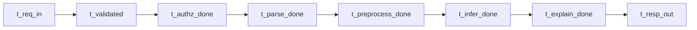

# 延遲預算與量測規格 v1

> 文件狀態：Draft v1 可審閱  
> 子任務：治理產物 C Performance Architect  
> 唯一依據：糖尿病風險預測輔助專案需求 MVP 資料型態與驗收指標

---

## 1. 文件目的與適用範圍

本文件定義 MVP 階段可落地之效能治理基線，供 PM 平台 後端 ML 共同會審，涵蓋：

1. 端到端延遲預算 v1
2. 量測口徑與測試情境 v1
3. 觀測與告警規格
4. 驗收對應與 Gate Must Should
5. 待平台 後端 ML 確認事項

適用流程僅限已知 MVP：

- 資料上傳
- 前處理
- 風險分數推論
- 結果解釋
- 報表匯出

資料前提：去識別化 CSV 約 5 萬筆。

主驗收口徑：線上單筆請求 E2E 延遲，以 API 收到到回應送出，不含網路，P95 小於 500ms。

---

## 2. 端到端延遲預算 v1

### 2.1 E2E 分段定義與預算

E2E 範圍為 API 入口收到請求至回應完成送出，不含外部網路傳輸。以下為 v1 分段預算，以 P95 累積不超過 500ms 為設計基線。

| 段次 | 流程分段 | P50 目標 ms | P95 預算 ms | P99 目標 ms | 量測點起訖 | 主要風險備註 | 超標處置策略 |
|---|---|---:|---:|---:|---|---|---|
| S1 | 請求接收與基本驗證 | 12 | 25 | 40 | `t_req_in` 到 `t_validated` | 請求體過大或欄位缺失造成重試 | 啟用請求大小上限 欄位早期拒絕 錯誤快返 |
| S2 | 身分授權與配額檢查 | 10 | 20 | 35 | `t_validated` 到 `t_authz_done` | IAM 或快取抖動 | 權限快取 預熱 token 驗簽路徑降級 |
| S3 | 檔案解析與結構檢核 | 25 | 60 | 90 | `t_authz_done` 到 `t_parse_done` | CSV 欄位漂移 編碼異常 | Schema 版本白名單 解析器流式化 異常列截斷策略 |
| S4 | 前處理與特徵轉換 | 40 | 100 | 150 | `t_parse_done` 到 `t_preprocess_done` | 特徵衍生邏輯複雜 缺失值補值成本高 | 向量化運算 特徵快取 固定轉換圖譜 |
| S5 | 風險分數模型推論 | 35 | 120 | 180 | `t_preprocess_done` 到 `t_infer_done` | 模型載入抖動 CPU 爭用 | 模型常駐與預熱 批內重用推論執行器 資源隔離 |
| S6 | 解釋生成 | 25 | 90 | 140 | `t_infer_done` 到 `t_explain_done` | 解釋算法複雜度過高 | 使用近似解釋 快取常見模式 設定計算上限 |
| S7 | 回應序列化與審計記錄 | 10 | 30 | 50 | `t_explain_done` 到 `t_resp_out` | 序列化大型 payload 日誌同步阻塞 | 回應壓縮策略 非同步寫審計 批次 flush |
| 合計 | E2E API 內部延遲 | 157 | 445 | 685 | `t_req_in` 到 `t_resp_out` | 尾延遲受 GC 競爭與瞬時尖峰影響 | 保留 55ms 緩衝 以吸收尾端波動 |

### 2.2 延遲目標與 Gate 門檻

| 類別 | 指標 | Must | Should | 備註 |
|---|---|---|---|---|
| E2E | P50 | 小於 250ms | 小於 220ms | 內部 API 時間 不含網路 |
| E2E | P95 | 小於 500ms | 小於 450ms | 主驗收門檻 |
| E2E | P99 | 小於 800ms | 小於 700ms | 控制尾延遲 |
| 分段 | 任一段 P95 超標比率 | 不得連續 3 個觀測窗超標 | 超標窗占比小於 5% | 觀測窗預設 5 分鐘 |
| 分段 | S5 模型推論 P95 | 小於 150ms | 小於 120ms | 保障主路徑可擴充 |

### 2.3 量測點命名規範與關聯欄位

| 欄位 | 規格 | 要求 |
|---|---|---|
| trace_id | 全鏈路追蹤識別 | 必填 與審計日誌一致 |
| request_id | 單請求識別 | 必填 每 hop 不重複 |
| span_id | 分段識別 | 必填 對應 S1 到 S7 |
| model_version | 模型版本 | S5 必填 |
| endpoint | API 端點 | 必填 |
| scenario_id | 測試情境識別 | 壓測與驗收必填 |

---

## 3. 量測口徑與測試情境 v1

### 3.1 量測範圍定義

| 維度 | 定義 | v1 規格 |
|---|---|---|
| 網路是否納入 | 是否含用戶端到 API 間網路 | 不含網路 僅量測服務內部 |
| 暖機與冷啟 | 模型與程序是否已預熱 | 需同時量測暖機與冷啟 |
| 批次大小 | 單請求筆數 | 主口徑 batch equals 1 另量測 10 與 100 |
| 併發度 | 同時請求數 | 主口徑 20 並行 另測 50 100 |
| 資料規模 | CSV 列數 | 單筆推論主口徑 上傳另測 1 萬與 5 萬列 |
| 重試策略 | 超時與錯誤重試 | 關閉自動重試 避免稀釋延遲 |
| 快取狀態 | 特徵與權限快取 | 分別測試快取命中與未命中 |

### 3.2 測試資料與樣本抽樣原則

1. 使用去識別化 CSV，欄位分布需涵蓋正常值 缺失值 邊界值。  
2. 每情境固定資料版本與 schema_version，避免資料漂移干擾。  
3. 每情境需至少執行兩輪，取第二輪作穩態觀察，第一輪保留為暖機紀錄。  
4. 全部測試輸出須攜帶 trace_id request_id scenario_id。

### 3.3 測試情境清單

| 情境 ID | 類型 | 前提 | 測試步驟 | 樣本量 | 成功判準 | 失敗回報欄位 |
|---|---|---|---|---|---|---|
| SCN-01 | 正常流量 | 服務暖機完成 模型常駐 | 20 並發送出 batch 1 請求 連續 10 分鐘 | 至少 12000 請求 | E2E P95 小於 500ms 錯誤率小於 1% | scenario_id timestamp window_p50 window_p95 window_p99 error_rate top_segment request_id_sample trace_id_sample |
| SCN-02 | 尖峰流量 | 與 SCN-01 同配置 | 100 並發突增 5 分鐘 後回落至 20 並發 10 分鐘 | 至少 18000 請求 | 尖峰期 E2E P95 小於 650ms 回落後 10 分鐘內恢復至小於 500ms | 同 SCN-01 加 saturation cpu_pct mem_pct queue_depth |
| SCN-03 | 異常輸入 | 注入欄位缺失 型別錯誤 編碼異常資料 | 每 10 請求插入 1 筆異常請求 | 至少 6000 請求 含 600 異常 | 異常請求在 200ms 內快速失敗 且不拖慢正常流量超過 10% | invalid_reason validation_stage http_status affected_segment request_id_sample |
| SCN-04 | 大檔案上傳 | 準備 1 萬列與 5 萬列 CSV | 依序上傳並觸發解析 前處理 推論 解釋 報表 | 每檔至少 30 次 | 5 萬列檔案流程成功率 100% 且關鍵段無連續超標 3 個窗 | file_size_bytes row_count parse_p95 preprocess_p95 infer_p95 timeout_count trace_id_sample |
| SCN-05 | 冷啟情境 | 重啟服務清空模型快取 | 冷啟後立即送出 batch 1 請求 其後持續壓測 15 分鐘 | 至少 9000 請求 | 冷啟首分鐘可允許較高延遲 但第 5 分鐘起 E2E P95 回到小於 500ms | cold_start_flag warmup_duration first_min_p95 minute5_p95 model_load_ms |

---

## 4. 觀測與告警規格

### 4.1 指標清單

| 指標類別 | 指標名稱 | 維度 | 聚合方式 | 用途 |
|---|---|---|---|---|
| latency | e2e_latency_ms | endpoint scenario_id model_version | P50 P95 P99 | 驗收與 SLO 主指標 |
| latency | stage_latency_ms | stage S1 到 S7 endpoint | P50 P95 P99 | 定位瓶頸段 |
| error rate | request_error_rate | endpoint scenario_id | 比率 | 觀測可用性 |
| timeout | timeout_rate | endpoint stage | 比率 | 觀測逾時壓力 |
| resource | cpu_utilization_pct | service instance | 平均與 P95 | 觀測資源飽和 |
| resource | memory_utilization_pct | service instance | 平均與 P95 | 觀測記憶體壓力 |
| resource | gc_pause_ms | service instance | P95 P99 | 觀測尾延遲來源 |
| resource | queue_depth | service stage | 最大值與平均 | 觀測背壓風險 |

### 4.2 告警分級與處置 SLA

| 等級 | 觸發條件 | 通知對象 | 處置 SLA | 升級條件 | 最低處置動作 |
|---|---|---|---|---|---|
| P1 | E2E P95 連續 15 分鐘大於 500ms 或 timeout_rate 大於 5% | 值班平台 值班後端 值班 ML | 5 分鐘內確認 30 分鐘內提出緩解 | 30 分鐘未緩解自動升級至主管群組 | 啟用流量保護 降級解釋計算 保全審計軌跡 |
| P2 | 任一關鍵段 S4 S5 S6 P95 連續 3 個窗超標 或 error_rate 大於 2% | 平台 後端 ML 責任群組 | 15 分鐘內確認 2 小時內完成修復方案 | 2 小時未改善升級為 P1 觀察 | 回滾最近變更 調整資源配額 檢查快取命中 |
| P3 | 資源壓力接近飽和 例如 cpu 大於 85% 持續 30 分鐘 | 服務維運群組 | 4 小時內確認 1 個工作日內完成優化排程 | 重複三次觸發升級為 P2 | 建立容量調整單 與下版優化追蹤 |

### 4.3 與審計日誌關聯要求

1. 每筆延遲觀測記錄必須攜帶 trace_id request_id。  
2. 發生告警時，事件需寫入審計事件，至少包含 alert_level trigger_metric trigger_value trace_id_sample request_id_sample。  
3. 事故復盤報告需可從告警事件回查到該時段審計事件與請求樣本。  
4. trace_id request_id 命名規則需與審計治理文件一致，避免跨系統對不上。

---

## 5. 驗收對應

### 5.1 如何證明推論延遲小於 500ms 已達成

採證流程如下：

1. 以 SCN-01 正常流量為主驗收情境，量測 E2E 內部延遲，不含網路。  
2. 取得 e2e_latency_ms 連續觀測資料，輸出 P50 P95 P99 與樣本總數。  
3. 驗證主口徑 Gate：P95 小於 500ms。  
4. 交叉檢核 stage_latency_ms，確認無單段長期超標造成偶然達標。  
5. 抽樣 trace_id request_id 對照審計日誌，確認量測結果可追溯且不可否認。

### 5.2 Must Should 清單

| 類別 | 等級 | 驗收項目 | 判定標準 | 證據輸出 |
|---|---|---|---|---|
| 延遲 | Must | E2E 主口徑 | SCN-01 下 E2E P95 小於 500ms | 延遲報告與原始聚合檔 |
| 延遲 | Must | 尾延遲控制 | E2E P99 小於 800ms | 分位數統計報表 |
| 分段 | Must | 關鍵段穩定 | S4 S5 S6 無連續 3 窗超標 | 分段趨勢圖與告警紀錄 |
| 追溯 | Must | 關聯一致性 | 量測資料與審計日誌可由 trace_id request_id 串接 | 抽樣追溯報告 |
| 可用性 | Must | 錯誤與逾時 | request_error_rate 小於 1% 且 timeout_rate 小於 1% | 可用性統計 |
| 延遲 | Should | 穩態優化 | SCN-01 E2E P95 小於 450ms | 優化後對比報告 |
| 彈性 | Should | 尖峰恢復 | SCN-02 回落後 10 分鐘恢復到 P95 小於 500ms | 尖峰恢復曲線 |
| 可觀測 | Should | 告警品質 | P1 P2 告警無漏報 且含關聯欄位完整 | 告警抽驗報告 |

---

## 6. 待平台 後端 ML 確認事項

1. 主驗收口徑固定為 E2E P95 小於 500ms，不含網路，是否同意作為正式簽核口徑。  
2. S5 模型推論段預算 120ms 是否符合現行模型版本與硬體配置。  
3. 冷啟可接受緩衝期是否採第 5 分鐘起回到 P95 小於 500ms。  
4. S7 審計寫入採非同步策略時，審計一致性與落盤時序要求為何。  
5. SCN-04 之 5 萬列 CSV 測試是否需要拆分為上傳路徑與推論路徑分別簽核。  
6. 告警 P1 之 5 分鐘確認與 30 分鐘緩解要求是否與現行值班制度一致。  
7. stage span 命名與 trace 欄位是否完全對齊既有觀測平台欄位字典。  
8. 異常輸入快速失敗目標 200ms 是否需區分不同錯誤類型門檻。  
9. 解釋生成降級策略是否允許回傳精簡解釋而非完整特徵貢獻。  
10. 壓測期間是否允許啟用自動擴縮容，或需固定容量以便比較。  
11. queue_depth 與 gc_pause 指標是否已在所有服務節點可取得。  
12. 報表匯出流程是否應獨立制定非同步 SLA 並與線上推論 SLA 分離。

---

## 7. 版本控管

- 版本：v1 MVP 效能治理基線  
- 進版條件：平台 後端 ML 對第 6 節確認事項完成簽核  
- 下一版建議輸出：
  1. 各端點差異化延遲預算 v2
  2. 容量模型與自動擴縮容閾值
  3. 壓測腳本與報表模板標準化

